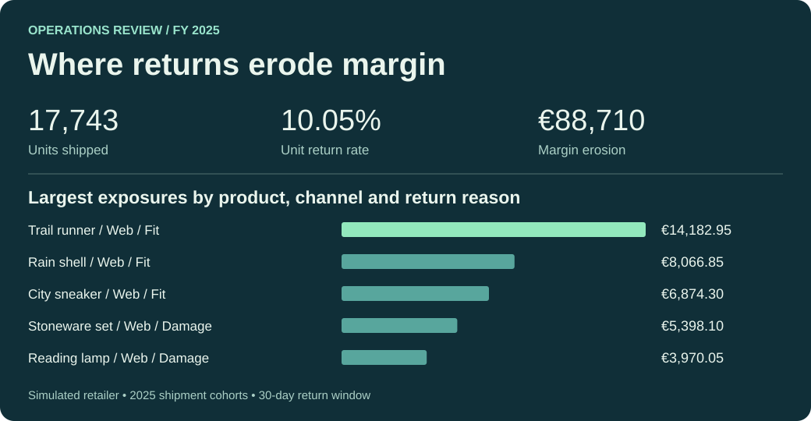

# Returns Review

**Which return problem should an omnichannel retailer fix first?** A merchandising manager has budget for one pilot. This portfolio case follows a fictional German retailer from shipment and return records to a ranked investigation list and an editable business case.



## The decision

Start with the **online trail runner size guide**. In this simulated year, 265 fit-related returns on this product and channel eroded €14,182.95 of margin, 15.99% of the portfolio total. Rain shell fit issues ranked second at €8,066.85. The code assigns return probabilities by product and channel, so these patterns illustrate the analysis method. Customer research and a controlled pilot would establish whether a new guide changes outcomes.

| FY 2025 shipment cohorts | Result |
| --- | ---: |
| Shipped units | 17,743 |
| Accepted returned units | 1,784 |
| Unit return rate | 10.05% |
| Refunds at actual selling price | €125,486.45 |
| Margin erosion including return handling | €88,709.95 |

## Explore the project

- **[Excel decision workbook](reports/Returns-review.xlsx)** — open the Decision tab and edit the two yellow cells. At a 15% reduction and €1,500 annual cost, the pilot yields €627.44 modeled net annual benefit. At 10%, it loses €81.71. Break-even is 10.58%.
- **[Power BI project](powerbi/Review.pbip)** — download the full repository. In Power BI Desktop on Windows, open Review.pbip and select Refresh. The first page shows shipment cohorts and category exposure. On the second page, select a return reason and inspect the product/channel detail. Sort the detail by Cost exposure descending. The model embeds the exported CSVs so local paths and database credentials are unnecessary.
- **[Step-by-step walkthrough](docs/walkthrough.md)** — trace one return, reproduce the analysis, explain the metrics and rehearse a two-minute demo.
- **[SQL briefing](sql/briefing.sql)** — compare channels, rank issues and trace returns across calendar months. Open the included [SQLite warehouse](data/mart/returns.sqlite) in a SQLite client and run the queries.

## Reproduce from scratch

Use Python 3.11 or newer. The data pipeline, report packaging and verification use the standard library. Run from the repository root. On Windows, substitute `py` for `python3` if needed.

```sh
python3 src/generate.py
python3 src/build.py
python3 src/powerbi.py
python3 src/figure.py
python3 src/verify.py
```

The generated raw files and reporting outputs are included for immediate use. The first command replaces the three synthetic source extracts. To analyze modified extracts, start with the second command. The verification script deliberately checks the published reference snapshot. Rebaseline its expected figures after reviewing an intentional data change. The included GitHub Actions workflow repeats this sequence on a push or pull request.

The Excel workbook is a separate, formula-driven snapshot. Its source tabs contain the two published marts. See the walkthrough for refreshing Excel after a data change. Its optional JavaScript authoring source is in `src/workbook.mjs` and requires the OpenAI artifact-tool environment. The shipped workbook opens independently in Excel.

## Architecture

| Stage | Tool | Output and purpose |
| --- | --- | --- |
| Source systems | Python, CSV | Repeatable catalog, sales lines and accepted unit returns with 12 overlapping extract rows |
| Ingestion and quality | Python, SQLite | Exact-repeat removal, conflicting-key rejection, foreign keys, quantity/date checks and reconciliations |
| Metric layer | SQL | Event costs, line economics, shipment cohorts and ranked opportunities using CTEs, joins and window functions |
| Exploration | Power Query, DAX, Power BI | Two report pages with weighted rates and euro measures that respond to filter context |
| Decision support | Excel | Editable intervention assumptions, net benefit and break-even threshold |
| Reproducibility | Git, GitHub Actions | Source-controlled metrics and cross-output checks |

## Scope and assumptions

Calendar year 2025 shipments include accepted returns up to 30 days later, through January 2026. All prices are modeled in EUR excluding VAT. A restocked unit recovers its full catalog cost. A written-off unit recovers zero. Each return receives a per-unit handling charge. There are no exchanges, salvage proceeds, fixed overhead, shipping revenue or customer identities. Two independent aggregate tables serve two distinct Power BI pages. The reason table contains returned units only and cannot supply a return-rate denominator.

Power BI project format reference: [Microsoft Learn](https://learn.microsoft.com/en-us/power-bi/developer/projects/projects-overview).
